# Vesperdeep — World and Region Design

**Phase 2 final design specification · INTERNAL / STORY SPOILERS.** Twelve authored rooms, three regions, three boss arenas (two minibosses + one two-phase final boss). Every room and edge listed here is a **new Phase 2 design proposal**, not an extracted Hollow Knight room. Links: [`gameplay-progression.md`](gameplay-progression.md), [`complete-script.md`](complete-script.md), [`reference-traceability.md`](reference-traceability.md).

## 1. World design principles

- **One spine, two rings:** a clear intended first-run path plus two cross-region shortcuts for return journeys. No required key hides behind optional exploration.
- **Three strong silhouettes:** grey tide/handwritten paper → damp green bell machinery → brittle pale glass. Avoid building 12 distinct art pipelines.
- **See the future gate before owning its solution:** the dash gap is visible before the Toll Warden; the Bell Engine's sigil gate is foreshadowed at C1 and explained at C2; G4's final dash test is visible from G3.
- **Readable recovery:** checkpoint before the first miniboss approach (M2 with M3 runback latch), before the second approach (C1), and immediately outside the final boss (G3); G1 provides a fourth checkpoint for the last region's traversal. Entering each boss arena reselects its corresponding already-visited nearby shrine as retry checkpoint, so optional backtracking cannot lengthen a boss runback unexpectedly.
- **Room identity independent from scene architecture:** evidence proves the original game's named room transitions, bounds and persistent state patterns; this plan chooses only 12 rooms, not the source's hundreds.

## 2. Topology overview

```mermaid
flowchart LR
 M1["M1 Wreckfall"] --> M2["M2 House of Kept Names"]
 M2 --> M3["M3 Ossuary Steps"]
 M3 --> M4["M4 Tollhouse • miniboss 1"]
 M4 -->|"Echo Step gap"| C1["C1 Sluice Landing"]
 C1 --> C2["C2 Silence Archive"]
 C2 --> C3["C3 Bell Engine • miniboss 2"]
 C3 -->|"relay opens"| C4["C4 Hollow Basilica"]
 C4 -->|"Resonance Sigil gate"| G1["G1 Glass Gate"]
 G1 --> G2["G2 Pale Orchard"]
 G2 --> G3["G3 Mirror Gallery"]
 G3 -->|"Echo Step gap"| G4["G4 Cradle • final boss"]
 C2 -.->|"hatch opened from C2"| M2
 G3 -.->|"latch opened from G3"| M3
```

**Mandatory first-encounter flags:** M2→M3 requires `edda_met`; C2→C3 requires both `thren_met` and `engine_objective_known`; G2→G3 requires `asha_met`. Each is set only after an unavoidable first exchange at the sole onward threshold, with optional earlier interaction equivalent. Interrupted exchanges re-trigger. The later cross-links cannot provide an earlier bypass. No quest item is used for these story thresholds.

**Rule for all edges:** arrows on the spine show intended first-arrival direction, **not** one-way travel. Once open, spine connections work both ways. Dashed cross-links are locked from the starting side and become two-way after opened from the far side. The final G4 entrance has a returnable platform and can be exited before triggering the fight. A boss arena's door locks **only while an encounter is active**.

## 3. Region I — Mourning Shore (M1–M4)

**Identity:** ash-silver tide, blank labels, petrified reeds, bells that produce no sound. Narrative: the cost of losing names and relationships. Challenge: basic jump, wall-slide/jump, directional slash, short pogo; first miniboss tests ground reading. Approximate first-pass budget **17 minutes**, including introduction, interactions and one plausible retry.

| Room | Landmark, playable layout and enemies | Critical content | Optional return / production note |
|---|---|---|---|
| **M1 Wreckfall** | Flat wreck ledge, shallow reversible drop, 3 safe jump platforms, first passive hanging target | Tutorial movement; first distant filtered Listener broadcast | Single foreground wreck kit; **no lethal tutorial pit** |
| **M2 House of Kept Names** | Short sheltered hub; **only path onward to M3 passes Edda/Pip's first-scene trigger**, no enemies | Mandatory first Edda/Pip conversation before M3 exit; first shrine/checkpoint; clear Warden objective | Cannot dash/jump or re-enter via later shortcut to skip scene; return dialogue optional, jars do not require interactions |
| **M3 Ossuary Steps** | Small wall-jump shaft with visible upper barred gate; 2 Paper Drudges; short platform loop | Toll approach latch `m3_toll_latch_open` ensures a fast runback; leads M4 | Gravestone + Rell note; upper door is the **late G3 shortcut**, inaccessible from M3 on first visit |
| **M4 Tollhouse** | Rectangular bell deck, safe floor on either side, no lethal pits during boss | **Toll Warden** arena; first relay disabled; **Echo Step** pickup and protected practice notch | The short gap to C1 requires dash. Defeated Warden remains inactive on reload |

**Gate M4→C1:** 1 dash-length dry gap over a draining culvert, safe to retry via a landing lip; a noncombat shadow of the dash span at M3 foreshadows it. `echo_step_owned` is the only condition. **No double jump or wall jump upgrade** required.

**M3↔G3 return link:** an initially barred upper tunnel is visible but out of reach; G3's latch opens it as a two-way passage with a safe drop/ascending ledges, allowing revisits to M2 without bypassing mandatory boss acquisition on first arrival.

## 4. Region II — Choirwater (C1–C4)

**Identity:** submerged bells, thin green light, copper-pipe echoes, ink running upstream. Narrative: reduction of experience to a single approved rhythm. Challenge: dash across interruptions, read projectile telegraphs, attack while managing a narrow platform. Approximate first-pass budget **18 minutes** (arrival through second miniboss).

| Room | Landmark, layout and enemies | Critical content | Optional return / production note |
|---|---|---|---|
| **C1 Sluice Landing** | Dry platform hub after gap; one pipe walkway; 1 Paper Drudge | Shrine/checkpoint; readable statement that a Bell Engine locks the Glass route | Room-to-room view of Basilica silhouette only; no traversable route to G1 yet |
| **C2 Silence Archive** | Two tiers of shelves, small safe fight against 1 Choir Needle and 1 Drudge; **C3-bound passage crosses Thren's trigger** | Mandatory first Thren exchange before C3; instruction to claim Cantor's sigil | Hatch **opened from C2** becomes two-way C2↔M2; hatch use and lore remain optional; cannot bypass Thren on first route |
| **C3 Bell Engine** | Round basin arena with low central platform and wide edges; no rising water physics | **Bell Cantor** arena; disables Choir relay; awards **Resonance Sigil** | Before defeat, door to C4 is sealed. After defeat, relay lift settles and C4 opens |
| **C4 Hollow Basilica** | Short chapel traversal with 1 Choir Needle, sigil-reading gate ahead | Underlines relief vs coercion; displays seal to G1 | Shrine not duplicated; optional prayer on bench; gate persists open |

**Gate C3→C4:** `cantor_defeated && choir_relay_off`. The sigil is awarded atomically at defeat to prevent a path that is open without the pass item.  
**Gate C4→G1:** `resonance_sigil_owned`, visually indicated at C1 and stated by Thren. The seal simply opens on approach; no separate gear, puzzle, quest journal or dialogue chain.  
**C2↔M2 hatch:** opened from the C2 side by a reachable lever; if ignored, the main spine still works. It is optional and never necessary for progression.

## 5. Region III — Glass Conservatory (G1–G4)

**Identity:** nearly white transparent branches, reflections that lag their owners, one green living seed. Narrative: perfection through arrested growth; love mistaken for ownership. Challenge: apply dash amid exposed walkways and fight a boss in two readable phases. Approximate first-pass budget **25 minutes** including final boss and ending.

| Room | Landmark, layout and enemies | Critical content | Optional return / production note |
|---|---|---|---|
| **G1 Glass Gate** | Sigil gate exit, stable platform and one split-level bridge | Checkpoint and definitive entry to the Conservatory | 1 Glass Moth to introduce dive warning before G2 |
| **G2 Pale Orchard** | Walkable ground, low reflective panes, 2 Glass Moths; **the sole G3-bound path crosses Asha's safe dialogue patch** | Mandatory Asha first exchange unlocks G2→G3, without item or extra quest | No jump/dash bypass or other incoming first-visit route; optional glass pattern must not identify Wyrm |
| **G3 Mirror Gallery** | Two-level mirrored path, a dashable floor-level hole, framed empty throne panel; **required latch on sole path to G4** | **Pull Mirror Latch** to unlock G4 approach and G3↔M3 shortcut; then shrine/checkpoint before G4 | **Using** G3↔M3 shortcut optional; opening latch mandatory. Optional inscriptions cannot show identifying crown |
| **G4 Cradle** | Single stable arena, two symmetric walls, protected entrance platform, no instant-kill pits | Masked Listener phase one → S12 reveal/Veyra sacrifice (first completion only) → Last Wyrm phase two → ending | Entire finale is **one arena and one encounter**. **Death in either phase returns to G3 and resets to Listener Phase 1**; no Phase 2 shrine or skip |

**Gate G3→G4:** requires **`asha_met && mirror_latch_open && echo_step_owned`**; dash over a single clear break after the latch has opened the approach barrier. Owned Echo Step is guaranteed since the only first-visit path through M4 required it. There is no unteachable late skill requirement. Camera bounds must make both sides of the jump visible before the player leaps.

## 6. Interconnected exploration & backtracking

| Route | When accessible | Why a player might use it | Risk control |
|---|---|---|---|
| M2–M3–M4–C1 | After M4 Echo Step | Primary travel; former Shore workers begin speaking partial words | First boss flag survives checkpoint death |
| C2–M2 hatch | Open from C2 at any point after arrival | Revisit Edda/Pip or pick up Rell's story clue | Cannot enter C2 early from M2 because hatch starts barred |
| G3–M3 mirror tunnel | **Must open** Mirror Latch in G3 to reach G4; shortcut opens in that same action | **Using the link** for return travel is optional | Cannot bypass Edda, Thren, Asha or C3 on first arrival; latch persists after death |
| G3–G4 | Echo Step and approach trigger | Both-phase final-boss challenge / full-encounter retries | **G3 shrine** 1 short screen away; dying in **either** final phase restarts next attempt at **Listener Phase 1**, not directly at Wyrm |

**Return-world changes:** M2 jars ring faintly after Shore relay; C1 water becomes audibly uneven after Choir relay; G2 orchard no longer reflects perfectly after the first completed S12 and Veyra is no longer physically present; the player may revisit G2 after a failed final attempt without generating a second living Asha/Veyra. These are lightweight ambient state changes; no required extra visit. The game does **not** require every shortcut or optional lore item to finish.

## 7. Hazards and accessibility/readability rules

- Pit hazards: one-step setback to the most recent **room-local safe landing**, not permanent checkpoint death, unless an enemy's attack is separately fatal. The scene reference confirms distinct hazard and durable-respawn concepts, not their original numeric tuning (`06-world-and-progression.md`).
- All required gaps have a safe start, visible landing and sufficient room to align; platforms use consistent height increments calibrated to **our** jump physics.
- Boss arenas are free of instant-kill pits. The Cantor and Last Wyrm create temporary telegraphed danger zones only. Asha's patch is a safe dialogue area.
- For audio motif puzzles/attacks, every audible warning has synchronized visual anticipation. Sound is atmosphere, never the sole way to react.
- No camera scroll should reveal the next enemy fewer than a proposed 1.0 s of reaction time away. Adjust by playtest; Phase 1 did **not** verify runtime camera feel.
- Re-entered defeated boss rooms remain peaceful; ordinary enemies reset only on death/rest. Persistent gates, dialogue completion, first-item pickups and boss kills do not reset.

## 8. Camera and presentation brief

- Exploration uses comfortable centered following with gentle facing look-ahead, room bounds and independent vertical tracking where needed. Values are **original calibration targets**, not extracted exact Hollow Knight settings.
- Narrow shafts bias the camera upward without exposing a false exit; M3 and G3 use separate lock rectangles.
- For M4, C3 and G4, fade to a fixed intro target then lock to an arena rectangle after player control is returned. Active attacks never occur before telegraphs are in frame.
- Phase break in G4: lock fixed camera and controls, stage close-up, resume with a slightly wider framing for the large single-silhouette Wyrm. No camera/scene reload needed during the cinematic.
- Reuse one transition fade style (approximately 0.25–0.45 s, **proposal**). One screen shake family for strong impacts. Avoid complex weather/effect systems.

## 9. World checklist and explicit unknowns

**Routing invariants:** D3 fixes **Godot 4** as future engine, Linux as primary development OS and Linux/Windows as targets, with keyboard/controller parity; these are **design handoff constraints**, not evidence of an implemented project. Only 12 room IDs M1–M4/C1–C4/G1–G4; no unlinked rooms; no gate requires an item obtained past itself; every boss has a prior reachable shrine. The first-run mandatory passages force Edda in M2, Thren in C2, and Asha in G2 before their exits; no shortcut grants early access around them. Two cross-region shortcut gates can only open from their far sides. **C2 hatch opening/use are optional; G3 latch opening is mandatory but shortcut use optional.** G4 requires dash, prior sigil route, Asha scene and G3 latch. See executable-independent state tests in [`implementation-handoff.md`](implementation-handoff.md).

**Reference evidence gaps:** the extracted Phase 1 material **does not contain** the actual 501-room connectivity, ordinary exploration camera rigs, representative ability-locked exploration doors or authoritative hazard-spawn dimensions. Room dimensions, jump distances, art palette and all combat placements here remain **Phase 2 design proposals** to be tested in a future phase, not reference facts.
